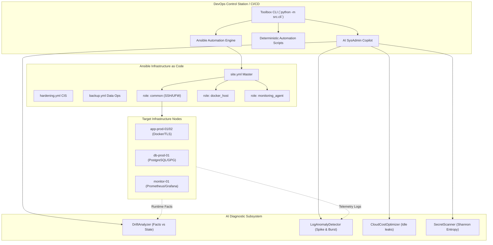

# Architecture Reference - DevOps Toolbox & AI SysAdmin Copilot

## 1. High-Level Architecture

The **DevOps Toolbox** is engineered as a foundational automation suite combining standard configuration management (Ansible), deterministic shell and Python automation scripts, and an AI-driven operational diagnostic layer (AI SysAdmin Copilot).

---

## 2. Component Breakdown

### A. Configuration Management (Ansible 2.15+)
- **Role `common`**: Installs baseline utilities, enforces ANSSI/CIS benchmarks on `/etc/ssh/sshd_config`, configures UFW with a default-deny policy, synchronizes clocks via Chrony NTP, and configures fail2ban.
- **Role `docker_host`**: Configures Docker Engine with daemon hardening (`no-new-privileges: true`, log rotation limits, unprivileged daemon rules).
- **Role `monitoring_agent`**: Sets up Prometheus `node_exporter` under dedicated unprivileged system users (`node_exporter`).

### B. AI SysAdmin Copilot
1. **Log Anomaly Detector (`src/ai/log_anomaly_detector.py`)**:
   - Parses multi-dialect server logs.
   - Computes weighted severity ratios and error burst density.
   - Evaluates Shannon entropy of error signatures to identify novel incident spikes.
   - Produces structured actionable incident reports with remediation suggestions.
2. **Configuration Drift Analyzer (`src/ai/drift_analyzer.py`)**:
   - Compares declared Ansible state variables against runtime machine facts.
   - Detects missing packages, unauthorized listening ports, and sysctl deviations.
   - Computes compliance score and auto-generates Ansible remediation tasks.

### C. DevOps Automation Tooling
- **Secret Scanner (`scripts/python/secret_scanner.py`)**: Pre-commit / CI credential scanner using regex patterns and Shannon entropy scoring.
- **Log Rotator (`scripts/python/log_rotator.py`)**: Automated gzip rotation, retention purging, and zero-downtime file truncation.
- **Cloud Cost Optimizer (`scripts/python/cloud_cost_optimizer.py`)**: Detects idle compute instances and unattached storage volumes to reduce unnecessary expenditures.
